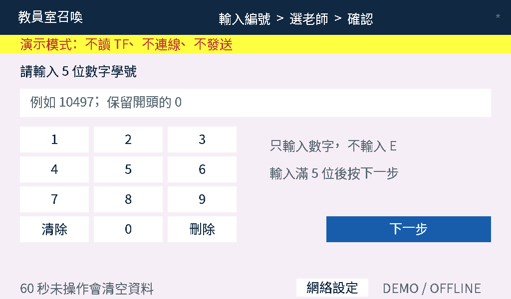

> ### ⚠ 這份指南寫在「唯一設定檔」之前
>
> 它是一套完整安裝的作業手冊，硬體接線、供電、驗收、故障排除的內容都還有用，
> 但裡面提到的 `tools/make_config.py`，以及逐檔手改 `firmware/*/config.h` 的做法，
> **已經被 `tools/apply_config.py` 取代**。
>
> 請以 [README.md](README.md) 與 [docs/燒錄與硬體.md](docs/燒錄與硬體.md) 的流程為準，
> 本文當作硬體與驗收的參考資料。
>
> 文中出現的 `<專案根目錄>`、`<備份目錄>`、`<本機路徑>` 等是脫敏後的佔位字串，
> 請自行代換成你的實際路徑。

---

# 教员室召唤系统

现场安装 · 调试 · 网络配置 · 交货操作手册

**网络更新版 v0.3 / 2026-10-10**

门口输入恰好 5 位数字 → 核对脱敏资料 → 选择老师 → 室内显示和广播。

**硬件不变：**Door 为 Waveshare ESP32-S3-Touch-LCD-7B；Audio 为 ESP32-S3 N16R8 + SPI microSD + PCM5102A + 有源 AUX 喇叭；Matrix 为 Waveshare ESP32-S3-RGB-Matrix + P5 64×32 HUB75。所有业务程序通过 Arduino / USB 烧录，TF 不用于安装程序。

| 你现在的状态 | 执行路线 |
| --- | --- |
| 已有另一 AI 优化安装 | 先备份 → 第 31 节保留原配置升级 → 第 32-39 节网络及五位编号 → 现场验收 |
| 全新硬件尚未接线 | 第 01-30 节逐模块安装；网络操作补读第 32-38 节 |
| WAV 已录好 | 保留原文件名；用 audioFile 映射五位编号；不重新生成声音 |
| 软件检查与实际交货 | 软件测试在 TEST_REPORT；实物仍须接线、上传、试听、搬位和断电验收 |

**本次保留：**原优化版的右上角 * 欢迎语、中文滚动、老师优先播报、队列/去重和重试保护。新增管理 PIN 网络页、IP/MAC、Audio IP 测试/寻找、临时热点同步和 IP 语音。学生页只有数字键盘，管理页才有字母符号。

> [STOP] 不覆盖老师原 PDF、原安装、真实配置或你的 WAV。公开包 config.h 为占位符；既有接线和已核对 GPIO 必须从原配置保留。Matrix 安全锁未确认不能开。先备份后操作。

本手册 40 页，章节号 + 1 即页码；新增升级/网络章节 31-39。程序和本文件是一套，不混用旧 ZIP。
<!-- PAGE -->
## 01｜交货路线、物料与文件

**目标：**先把一套 A 完成；B 套只在 A 全部合格后复制部署。

| 模块 / 数量（每套） | 标签与所需附件 | 操作章节 |
| --- | --- | --- |
| Door 主板、集成 LCD/触控 ×1 | A-Door；门口 TF、数据线、合适电源、外壳 | 03、05-07、21 |
| Audio N16R8 ×1 | A-Audio；SPI SD 模组、语音 TF、数据线 | 04、08-17 |
| PCM5102A + 有源喇叭 | DAC、AUX 线、各自适配的供电 | 15-16 |
| RGB-Matrix + P5 ×1 | A-Matrix；HUB75 排线、屏电源线、支架 | 18-20 |
| 网络、验收、安装 | 获批准的 2.4GHz LAN、电脑、记录表 | 11-12、22-39 |

1. 点算：每套两张建议 16GB TF；两套共四张。本版不使用 Matrix 板 TF 插槽，不需要第三张卡。
2. 准备：读卡器、万用表、绝缘工作垫、螺丝批、PCB 支柱、可靠接头和绝缘材料。学生不得操作裸板接线。
3. 解压交付 ZIP。业务工程在 `firmware/Door`、`firmware/Audio`、`firmware/Matrix`；网络测试在 `firmware/NetworkCheck`。
4. `sd_first_test` 是你当前两段录音对应的 CSV；`sd_templates` 是扩展示例，不可直接当作所有录音都齐全的正式卡。
5. `tools` 是电脑端准备工具；`docs` 是 PDF；`HARDWARE_WORKSHEET.md` 填接线；`ACCEPTANCE_CHECKLIST.csv` 填结果；`TEST_REPORT.md` 是软件验证范围。

**定位方法：**本 PDF 章节号加 1 即页码，例如第 07 节在第 8 页、第 14 节在第 15 页。已有优化版先看第 31 节；新安装先完成卡资料与网络配置，再按各模块测试；不要把章节号当作必须边读边带电接线的顺序。

**通过标准：**物料贴好 A/B 与角色标签，知道每块板对应哪个工程、哪张卡。**故障：**若硬件型号不同，先停止该模块，不按“长得相似”套用针脚。
<!-- PAGE -->
## 02｜电脑目录、备份与终端

**目标：**所有修改先在电脑副本完成，不误格式化原卡，不直接编辑 ZIP。

1. 在资源管理器新建 `<專案根目錄>`，右键交付 ZIP →“全部解压缩”，得到 `<專案根目錄>\staffroom_kit`。右键此目录复制一份作原始备份；以后 A/B 正式设置各用自己的副本。
2. 打开“查看 → 显示 → 文件扩展名”。Windows 10 可在“查看”勾选“文件扩展名”。必须能看见 `.csv`、`.wav`，防止保存成 `.csv.txt`。
3. 只插原有语音卡到读卡器。打开“此电脑”，记下新增盘符、容量、卷标；双击确认有 `students`、`teachers`、`chime.wav`。不要凭记忆认 E:。
4. 将整卡内容复制到电脑受管目录，如 `<備份目錄>`。随机打开两段 WAV试听；确认备份能读后，点任务栏“安全删除硬件”弹出卡。没有第二份可读备份不格式化。
5. 安装受信任来源的 Python 3；终端运行 `py --version`。打开套件文件夹，地址栏输入 `powershell` 回车；命令应在该套件目录执行，而不是 `C:\Windows`。

```powershell
Get-Location
py --version
py -m pip install -r requirements.txt
py -B tests\test_readonly.py
```

**通过标准：**终端目录末尾是 `staffroom_kit`；版本号出现；只读测试显示 `OK`。测试需要 Pillow，不会读写你的 TF。学生个人资料不得放公开同步盘。

**常见问题：**`py` 找不到：重开终端，或用已安装 Python 的完整路径；`No module named PIL`：重跑依赖安装；中文乱码：用 `py -X utf8` 执行脚本。`tmp` 是生成/测试中间目录，不复制到 TF，也不是运行系统所需资料（见 28）。
<!-- PAGE -->
## 03｜Arduino 安装与烧录通用操作

**目标：**固定一套已编译基线，三块板分别选参数；不随意升级库。

1. 安装 Arduino IDE 2.x。文件 → 首选项 →“附加开发板管理器网址”，添加 Espressif 官方索引；已有网址不要覆盖。
2. 左侧开发板管理器搜索 `esp32`，选 Espressif Systems，安装 **3.3.7**。库管理器安装 **ArduinoJson 7.4.3**。Matrix 另装 **Adafruit GFX 1.12.4**、**Adafruit BusIO 1.17.4**。
3. 文件 → 打开完整目录内的 `.ino`，例如 `firmware\Door\Door.ino`。不单独搬走 `.ino`；同目录 `.h/.cpp` 都必须保留。选 `ESP32S3 Dev Module`。

| 工程 | Flash / PSRAM / 分区 | USB CDC On Boot |
| --- | --- | --- |
| Door 7B | 16MB / OPI / 16M Flash（3MB APP/9.9MB FATFS） | Disabled；接 USB TO UART |
| Audio N16R8 | 16MB / OPI / 同上 | 本包基线 Enabled；串口路径须与实板一致 |
| Matrix N32R16 | 32MB / OPI / 32M Flash（4.5MB APP/24MB FATFS） | 本包基线 Enabled；按官方接口 |

4. CPU 240MHz；USB Mode 基线 `Hardware CDC and JTAG`；首次 Upload Speed 115200。实际板版本或下载接口不同，先查官方示例；不要照搬 CDC 后找不到日志。
5. 只接一块板到数据 USB。工具 → 端口，比较插拔前后新增 COM。点“验证 ✓”只编译；无错误再点“上传 →”。上传会覆盖板内原程序，卡不参与烧录。
6. 出现上传完成后按 RESET，打开串口监视器，选 115200。进入下载困难时按本板官方 BOOT/RESET 流程，不短接未知针脚。

**通过标准：**编译和上传无错误、正确串口有本工程日志。**故障：**无 COM 先换数据线/接口；仅安装实板串口芯片对应的官方驱动；缺头文件检查工程是否完整；菜单无 OPI/32MB 检查是否误选非 S3。官方测试工程若需其他依赖，另按其文档，不混进本包 Door（不依赖 LVGL）。
<!-- PAGE -->
## 04｜Audio 主板：裸板与供电测试

**目标：**先证明 N16R8 能烧录、启动、联网；不把外接模块问题混进来。

1. 拍清正反面型号、USB 接口标签和串口芯片。记录板次与 N16R8；若不是相同内存规格，停止使用第 03 节参数，改按其厂商资料。
2. 拔掉 SD 模组、DAC、喇叭及外部电源。裸板放绝缘垫。只用一条可靠数据 USB 接电脑；没有外接电源时才按此测试方式执行。
3. 打开 `firmware\NetworkCheck\NetworkCheck.ino`。把两个 `CHANGE_ME` 改成获批准的测试 Wi-Fi 名称/密码，保留双引号与分号。NetworkCheck 仅测普通 Wi-Fi；校园账号网络改用正式端的第 34 节。诊断配置独立，不由 make_config 更新。
4. 按第 03 节 Audio 参数验证、上传、重启。开串口 115200。应先见 `NETWORK CHECK MAC=...`，联网后见 `CONNECTED IP=... MAC=...`。抄 MAC 和实际 IP 到记录表。
5. 拔 USB 断电，等指示灯灭，再插回；重复三次，确认均能启动且串口不是连续重启。只观察标识 LED，不用“某 LED 没闪”判断烧录失败。
6. 准备独立运行电源前先读该板供电接口规格，核对输出电压、极性、容量；接外部低压电源前断 USB。不得同时并联两个未知 5V 来源。

**通过标准：**三次冷启动正常，至少一次获得本校批准 LAN 的 IP。记录 `板型号/COM/CDC/供电方式/MAC/IP`。这一步没测试 SD、音频或队列，之后必须刷 Audio 正式程序。

| 问题 | 按顺序处理 |
| --- | --- |
| 完全没串口 / 无日志 | 换数据线 → 正确接口 → 对应芯片驱动 → CDC 与 USB 路径核对 → RESET |
| 一直 Waiting for approved... | 核对 2.4GHz、大小写、校园认证方式；不先接更多模组 |
| 反复重启或发热异常 | 立即断电；查线、电源和裸板短路；不以加大电压解决 |
<!-- PAGE -->
## 05｜Door 7B：LCD 与 GT911 触控

**目标：**先确认门口整板的显示和触控正常，再装交互程序。LCD 与 GT911 已在板上连接，正常安装无需自接屏幕信号线。

1. 断电看背面完整型号必须是 `ESP32-S3-Touch-LCD-7B`。拍板次，检查屏幕/排线和接口有无损伤。不要拔插 LCD/触控软排线来“试试”。
2. 打开第 30 节的 7B 官方资料，进入资源/示例下载，解压保留原件。查找同型号 Arduino 的 `06_LCD`、`08_TOUCH`；目录命名若变动，按功能找 LCD/Touch，不用旧 7 型号示例。
3. 在厂家要求的工具链/依赖环境中，先打开 LCD 示例，依其 README 设置 Flash、PSRAM、USB 与库。接板上 **USB TO UART** 到电脑；仅用厂家允许的单一供电入口，暂不接外部电源。
4. 验证 → 上传 → RESET。观察完整屏面颜色/图案，检查边缘有无固定缺行、抖动、方向颠倒。
5. 再打开 Touch 示例，同样验证上传。按屏幕/串口提示逐点触碰左上、右上、左下、右下、中心并拖动；观察对应标记或坐标变化。记录每个点，不只点中间。
6. 断电重启再看一次。保存成功的示例原件、IDE 设置截图和串口记录。不要把官方示例当作召唤程序交货。

**通过标准：**五个位置响应匹配，拖动连续，画面无明显撕裂或固定缺色；背光正常；已保存可恢复示例。

| 故障 | 排查 / 停步条件 |
| --- | --- |
| 黑屏或花屏 | 查是否 7B、OPI、板版本、供电；回到成功示例，不随机改 GPIO |
| 触控左右颠倒 / 偏移 | 先看官方示例是否同样错；记录坐标和方向，未解决不装门口 |
| 电脑供电不稳定 | 采用厂家允许的供电/编程组合；未确认隔离前不双电源并接 |

**供电记录：**原纲要门口为 5V 3A 适配器配置；实际接口与电源拓扑须按手上 7B 版本核对，不把适配器标称当作已测量结果。
<!-- PAGE -->
## 06｜Door 程序：先做不联网演示

**目标：**验证本包的 Arduino 原生键盘、老师选择、取消和清除；此阶段不会广播。

1. 打开总包 `firmware\Door\Door.ino`。应同时有 `UiView.h`、`UiTypes.h`、`DeliveryPolicy.h`、`ui_config.h` 等标签；缺文件就重新解压同一总包，不从旧 ZIP 拼凑。
2. 在 `ui_config.h` 将 `#define STAFFROOM_UI_DEMO 0` 改为 `1`。配置密码可仍留占位符；不需要 TF。按第 03 节 Door 参数验证、上传、重启。
3. 串口应出现 `DOOR DEMO: no SD, no Wi-Fi, no announcements`。屏幕有黄色演示标记。首页输入 `00001`（前导零保留），点“下一步”。
4. 应见班别及遮蔽姓名 `2A / 陳○文`。选择“李老師”进入确认；按“重新选择”应能返回，重新选中老师后点“演示確認”。
5. 应见“演示完成 / 沒有發送，也不會廣播”。约 5 秒自动回首页；也可按“下一位同學”。确认上一人的编号/姓名消失。
6. 重做 `99999`、`00002`；输入 `99998` 应拒绝；不足 5 位不能继续，第 6 位不能加入；测试“删除”“清除”。长按一键只输入一次；停留 60 秒应清空未完成输入。

**通过标准：**每个按钮位置可点、编号不丢零、返回/删除正确、无假广播。**故障：**黑屏先回第 05 节；中文方框先检查 `glyphs.h` 和第 10 节；联网图标/声音在演示模式不工作是预期，不改网线排查。

> [STOP] 演示成功不等于交货完成。正式时必须将 `STAFFROOM_UI_DEMO` 改回 `0` 并重新上传；只保存文件或按 RESET 不会更换编译模式。正式完整步骤在第 21 节。


<!-- PAGE -->
## 07｜Door TF：第二张卡装什么

**目标：**门口卡只放脱敏学生 CSV 与老师 CSV，负责编号查找；不存学生原声、完整姓名或密码。

1. 使用独立 TF，贴 `A-Door-TF`。先按第 02 节备份；资源管理器右键确认盘符/容量 → 属性查看文件系统。已是 FAT32 且可读，不为测试强制格式化。
2. 如需重建空白卡：确认备份后右键这张卡 → 格式化 → FAT32 → 卷标 `A_DOOR` → 再核对容量 → 开始。会删除全部卡内容；没有 FAT32 选项就停，不选 exFAT 硬试。
3. 首次只把 `sd_first_test\DOOR` **里面**两个文件复制到卡根目录。下列每段分别是一份文件，必须 UTF-8、逗号分隔、第一行表头不改。

```csv
studentId,class,maskedName
99999,TEST,測○生
```

```csv
teacherId,displayName
01,李老師
```

4. 在资源管理器应直接看到 `F:\students.csv`、`F:\teachers.csv`（F: 替换真实盘符），而不是 `F:\DOOR\students.csv`。记事本“另存为”选 UTF-8、文件类型“所有文件”；检查没多出 `.txt`。
5. 在套件终端执行以下命令，PASS 后安全弹出。Door 断电后插入板载 TF 插槽，再供电；此卡不用外置 SPI 模组。

```powershell
py tools\validate_sd.py F:\ --role door
```

**通过标准：**PASS、学生 1 人、老师 1 人；正式 Door 能查到 99999。`只有1位老师` 是提醒，不是故障。**故障：**找不到 CSV 查根目录/扩展名；`students_header_invalid` 查表头和列顺序；中文乱码改 UTF-8。Door 表头必须严格三列/两列，不可加 `displayName` 或 `audioFile`。
<!-- PAGE -->
## 08｜Audio TF：保留你的录音，补 CSV

**目标：**先启用编号 99999 / 老师 01，对应你已有 TEST001.wav / 01.wav，避免样本名册里其他人缺 WAV。

1. 先备份原卡（第 02 节）；确认 FAT32。复制 `sd_first_test\AUDIO` 内两个 CSV 到语音卡根目录；保留你已有的 `students`、`teachers` 目录和 WAV，别将整个 AUDIO 外层套进去。
2. 打开下面 CSV 核对姓名。这里的“測試學生/李老師”是虚构示例，**先听录音，再改成录音实际姓名**；两卡的老师编号与名称保持完全一致。

```csv
studentId,class,maskedName,displayName,audioFile
99999,TEST,測○生,測試學生,/students/TEST001.wav
```

```csv
teacherId,displayName,audioFile
01,李老師,/teachers/01.wav
```

```text
Audio TF 根目录
  students.csv
  teachers.csv
  students/TEST001.wav
  teachers/01.wav
  chime.wav                  （启用提示音时才必需）
```

3. `students.csv` 的 `displayName` 供室内屏显示；`audioFile` 是卡内路径，不是 `C:\...`。保留编号前导零、大写与 `.wav` 小写后缀。不要把中文姓名写成录音文件名。
4. 公开样板默认 `USE_CHIME=false`；升级保留原设置；原有 chime.wav 可保留但不会播放。改为 `true` 时必须在根目录放合格提示音，并在校验命令加 `--chime`。

```powershell
py tools\validate_sd.py E:\ --role audio --door F:\
```

**通过标准：**PASS 且两张卡编号集合、老师名称一致；再按第 09 节试听完整语句。**故障：**提示找不到 `000001.wav/02.wav`，多半误用了扩展示例；回到 first_test 模板，不造空 WAV 糊弄检查。两张卡无法同时插时，`--door` 可填门口卡的完整备份目录。
<!-- PAGE -->
## 09｜已有 WAV：核对内容、格式和播放顺序

**目标：**直接使用你已录好的 WAV，不生成或替换录音；实际听清老师和学生信息。

1. 保留原卡及 WAV 备份。电脑试听 students/TEST001.wav、teachers/01.wav、chime.wav，写下每段实际内容；CSV 显示名须对应实音。
2. **本优化版播放次序是 chime（启用时）→ 老师 WAV → 学生 WAV。** Matrix 第一行老师名，第二行学生名 + 同學找。原功能被保留，不自行改回学生优先。
3. 如果学生片段已有“某同学找”、老师片段已有“某老师”，按上述顺序试听是否符合学校批准的说法。程序不会从文字自动添加“同学找”或“老师”；不因文件名正确就签语句通过。
4. 格式检查：真正 RIFF/WAVE、PCM signed 16-bit、16000 或 22050 Hz、单/双声道、每段不超过 30 秒。支持的既有素材不转码、不改名。
5. 对卡备份目录执行下方检查；加 --chime 与实际开关一致。只读取，不修改。需要修正格式时，另存新副本并试听，由管理员批准后换卡；不要仅把 MP3 后缀改成 WAV。

```powershell
py tools\validate_sd.py E:\ --role audio --door F:\
# 启用提示音时，在上方命令末尾加 --chime
```

6. 尚未使用的其他录音可保留，不会自动加入名册。只有 CSV 引用的人员可被叫号。新增人员用第 10、39 节映射，不把五位 UI 编号误当作必须重命名 WAV。
7. 若已有 IP 数字录音，按第 38 节复制副本到 network；没有这些片段时普通叫号仍可工作，IP 从串口读取。

**通过标准：**工具 PASS，人工试听内容/人物/顺序正确。**可能问题：**格式不合格、音量差异、片段只有名字、缺尾音；分别处理，不靠重复叫号判断。串口 PASS 不证明喇叭真正出声。

> [NOTE] prepare_wav.py 是可选拼接工具，本次不执行，不要求你重做已有录音。
<!-- PAGE -->
## 10｜扩充正式名册与中文字库

**目标：**首次联调通过后，将完整主名册一次生成两卡，避免手工维护不一致。

1. 在受管目录新建 `private`（不公开），建立 `students-master.csv`、`teachers-master.csv`。用记事本 UTF-8 保存，或 Excel“数据 → 自文本/CSV”导入时将编号列设为**文本**；不要直接双击让 `00001` 变成 `1`。

```csv
studentId,class,displayName,audioFile
00001,2A,陳大文,/students/000001.wav
99999,TEST,測試學生,/students/TEST001.wav
```

```csv
teacherId,displayName
01,李老師
```

2. 学生使用恰好 5 位数字；旧 E+5位如 E12345 可输入 12345，不可与 12345 并存；不截取任意长编号。老师 ID 保留 1-24 位大写/数字/-/_，老师人数 1-15，超过 15 无分页。长老师名先在按钮上实测，必要时使用学校批准的简称。
3. 输出使用新的目录名；已存在会拒绝覆盖，这是保护，不是故障。按下面三条执行；命令末尾反引号表示 PowerShell 换行，不要复制注释文字。

```powershell
py tools\make_rosters.py private\students-master.csv `
  private\teachers-master.csv private\release-A-01
py tools\generate_fonts.py `
  --students private\release-A-01\AUDIO\students.csv `
  --teachers private\release-A-01\AUDIO\teachers.csv
```

4. 生成器创建 DOOR/AUDIO 两份 CSV。逐个补齐 AUDIO 所引用的学生和老师 WAV；一人一份，不只复制现有 TEST001。检查遮蔽姓名是否合适，再复制各目录**内容**到相应卡并运行第 07-08 节校验。
5. 字库工具会更新本套 `firmware\Door\glyphs.h` 和 `firmware\Matrix\glyphs.h`，扫描界面源码及名册。**改人名/界面用字后重新编译并上传 Door 和 Matrix**；换 TF 不会自动更新屏中文字。

**通过标准：**两卡校验 PASS；实屏所有新字可读；选到新增人员能完整播放。**故障：**缺 WAV 就补齐；出现方框/空字查字库生成时是否用了正式名册、是否刷到正确板；不将全校名册当作测试通过证据。
<!-- PAGE -->
## 11｜三端联网与实际地址

**目标：**Door → Audio → Matrix 真正互通，不只获得 Wi-Fi 图标。

1. 请学校网管批准 2.4GHz 受管 LAN；询问普通密码或 PEAP/TTLS-MSCHAPv2、CA、是否隔离设备。网页登录、5GHz-only、EAP-TLS 不在本版范围（第 34 节）。
2. 全新普通网络可逐板运行 NetworkCheck 抄 MAC/IP；校园账号网络使用正式程序。Door 的 IP/MAC 可在第 32 节页面或串口 STATUS 查看。诊断程序没有 LCD 驱动，刷到 7B 黑屏不等于屏坏。
3. 让三端加入获准网络。请网管允许设备间 TCP80；按需允许局域网 mDNS。**同 SSID 不保证互通；手动 IP 无法绕过访客隔离、VLAN 或防火墙。**
4. 推荐对 Audio、Matrix 各做 DHCP 地址保留，Door 可动态取址。重启确认实际地址。HOST 字段仅是接收者位置，不会把对方变成静态 IP。

| 角色 | 不能照抄的示例 | 现场记录 |
| --- | --- | --- |
| A-Audio | 192.168.4.1 | MAC：____ IP：____ |
| A-Matrix | 192.168.4.50 | MAC：____ IP：____ |
| A-Door | 192.168.4.10 | MAC：____ IP：____ |

5. Audio 状态使用 Door“测试 Audio”或 `py tools\probe_audio.py 实际AudioIP --system ROOM_A`，按提示输入本套设备密钥；直接浏览 /health 会返回 403（现在必须带密钥）。核对 role、systemId、ready、bootId。
6. Matrix 可浏览 /health 核对 MATRIX / ready / 本套身份；不把其无需密钥的健康接口当作设备角色强认证。业务 /display 仍要求密钥。
7. Wi-Fi 断开/恢复后重测；Audio 动态 IP 改变则按“自动寻找 Audio”或手填新地址，保存并测试。寻址是按键操作，不是每次开机都自动更新。

**通过标准：**正确套别、ready=true、实际试叫和显示通过。**问题：**超时查隔离/地址/电源；403 查密钥；404 查烧录工程。只部署受管 LAN，不做公网端口映射。
<!-- PAGE -->
## 12｜新安装配置；已有优化版不重置身份

**目标：**三端用同一套身份、正确接收地址和管理 PIN，避免覆盖已核对接线。

1. **已有 <專案根目錄> 优化安装：跳到第 31 节 prepare_upgrade。** 不对已验收原目录运行 make_config，不产生新 DEVICE_KEY，不把原 Audio GPIO 替换成 -1。
2. 全新安装：复制公开包为 A 工作副本。在套件目录执行下方命令；输入受管 Wi-Fi、实际 Audio/Matrix IPv4、ROOM_A、6-12位数字管理 PIN。密码/PIN 隐藏输入。

```powershell
py tools\make_config.py
```

3. 最后输入 YES 才写入 config 和 NetworkDefaults，并创建 .bak；本套随机密钥写三端。本工具保留其他参数，但**新安装安全锁重置 false**，按第 13-20 节核实才启用。

| 文件 | 本机核对，不截图泄露 |
| --- | --- |
| Door/config.h | SYSTEM_ID、DEVICE_KEY、AUDIO_HOST、MATRIX_HOST；原欢迎语 |
| Audio/config.h | 同套身份；MATRIX_HOST；7 GPIO；chime/测试模式与安全锁 |
| Matrix/config.h | 同套身份；面板参数与安全锁 |
| 三端 NetworkDefaults.h | NETWORK_ADMIN_PIN；企业认证按第 34 节配置 CA 等 |

4. 已有 .bak/.pending 会拒绝；先受管备份和人工核对，不删唯一备份。中断后逐份核对，不假设三端原子写入。
5. 改源码后重新编译上传。已保存 NVS 网络会覆盖源码网络：重新烧录不自动清它；需要恢复源码默认时按第 37 节 CLEARWIFI。
6. NetworkCheck 单独配置；测试/演示模式需逐一改回 0。本地源码、NVS、编译产物含网络凭证，只交给授权管理员。

**通过标准：**身份一致，IP 正确，PIN 可用，硬件锁有实物依据。**问题：**未知 config 字段先恢复完整副本；密码输入无字符是正常；安全锁 false 不是网络 bug。
<!-- PAGE -->
## 13｜Audio：SPI TF 模组接线

**目标：**按实物针脚把卡接到 N16R8。材料：裸板测试合格的主板、SPI microSD 模组、已备份语音卡、短信号线、万用表、接线表。

1. 关电源、拔 USB；检查主板、SD 模组正反面和官方针脚表。抄模组允许供电、电平转换方式；裸 3.3V 卡座与带稳压模组不能混同。未确认不接 VCC。
2. 在 `HARDWARE_WORKSHEET.md` 填四个 SPI GPIO 和三条 I2S GPIO 的候选分配，由懂该板的人对照原理图确认无冲突后签字。数值是 **GPIO 编号**，不是排针第几脚。
3. 断电下逐根接 GND，再接经确认的电源和四根 SPI 信号。每接一根在线两头贴相同标签；两人复核下面对应关系，不按导线颜色推断。

| 模组丝印 | Audio 程序参数 | 主板实际 GPIO / 核对 |
| --- | --- | --- |
| CS | PIN_SD_CS | ____ / ____ |
| SCK 或 CLK | PIN_SD_SCK | ____ / ____ |
| MISO 或 DO | PIN_SD_MISO | ____ / ____ |
| MOSI 或 DI | PIN_SD_MOSI | ____ / ____ |
| GND | 同主板 GND | ____ |
| VCC / VIN | 实物允许的供电轨 | ____ V / 依据 ____ |

4. 万用表先确认电源电压/极性；板断电时检查电源轨没有持续近零阻值等明显短路。电阻/蜂鸣档不能测带电电路。SD 返回主板的信号必须适合 3.3V GPIO。
5. 插入卡；暂不接 DAC 和喇叭。按已确认的单一供电方式通电，出现发热/异味立即断电，不反复插拔带电模块。

**通过标准：**接线表、丝印、`config.h` 一一相符，接头可靠，未触碰 Flash/PSRAM、USB、启动脚和板载器件。**故障：**若不知道可用 GPIO，停在本页交给技术人员核对；程序会拒绝 -1/重复/部分保留脚，但通过软件检查不代表所有板次都安全。
<!-- PAGE -->
## 14｜Audio：离线读卡测试程序

**目标：**不连 Wi-Fi、不接 DAC，证明卡可挂载并能读取现有两个有效 WAV。测试直接使用本包 Audio 工程，不必另找 SD 示例拼代码。

1. 开 `firmware\Audio\Audio.ino` → `config.h`。按签字表填写七个 GPIO（I2S 此时仅配置、尚不接线）。所有模组规格/分配核对后将 `AUDIO_PINS_CONFIRMED=false` 改为 `true`。
2. 将 `AUDIO_TEST_STAGE=0` 改成 `1`。暂用 `USE_CHIME=false`；Wi-Fi 可不用，但不要把本次测试误当正式接收服务。
3. 断电确认第 13 节 SD 接线、卡内 `students.csv`、`teachers.csv` 和两个 WAV。按第 03 节 Audio 参数验证、上传，必要时断外部电源后用已核准编程供电方式，不能双电源倒灌。
4. 打开串口 115200，RESET。读完等待，不需要输入 HTTP 命令；此模式不会连接 Wi-Fi或播放声音。保存完整输出。

```text
AUDIO TEST stage=1 ready=1 reason=
WAV /teachers/01.wav PASS
WAV /students/TEST001.wav PASS
AUDIO TEST PASS (listen separately in stage 2)
```

5. 若启用 USE_CHIME，还必须看到 `/chime.wav PASS`。测试只检查上述首次测试路径，不代替整张正式卡的 `validate_sd.py`。

| 失败输出 / 现象 | 处理次序 |
| --- | --- |
| pins_not_confirmed | 看锁、七个 GPIO、重复和保留脚；不能只把锁改 true 绕过接线核查 |
| sd_mount_failed | 断电 → 卡/FAT32 → VCC/共地 → CS/SCK/DO/DI → 短线/可靠接头 |
| roster_missing_or_invalid | 根目录两 CSV、UTF-8、表头和老师数量；先电脑校验 |
| WAV ... FAIL | 查准确路径/文件名，执行第 08-09 节，不能用空文件代替 |

**通过标准：**上面各项 PASS，重复三次冷启动结果一致。**限制：**PASS 尚不证明声音正常；诊断模式不会接受门口请求。下一页接 DAC 前必须断电。
<!-- PAGE -->
## 15｜PCM5102A 与有源喇叭接线

**目标：**将 Audio 的 I2S 接 DAC，再将 Line Out 接喇叭 AUX；不让 DAC 直接驱动无源喇叭。

1. 拔主板 USB、外部电源并关闭喇叭。拍 DAC 正反面、跳线/焊桥位置。核对**这块模组** VIN/VCC 电压、I2S 格式、XSMT 静音、SCK/MCLK 三线模式规定；芯片型号相同不代表模组相同。
2. 本程序为 Philips I2S、16-bit、立体声输出，单声道文件复制到左右声道；不提供 MCLK。必须确认该 DAC 模组可使用对应无 MCLK 三线方式，按厂商说明设置焊桥，不能随意接 5V 或留悬空。
3. 断电逐条接下表；保留第 13 节 SD 接线。主板、SD、DAC 共地，不同电源的正极不可擅自并联。

| DAC 丝印 | 对应主板参数 | 现场填写 |
| --- | --- | --- |
| BCK / BCLK | PIN_I2S_BCLK | GPIO ____ |
| LCK / LRCK / WS | PIN_I2S_LRCK | GPIO ____ |
| DIN | PIN_I2S_DATA（主板输出） | GPIO ____ |
| GND | 主板信号地 | 接点 ____ |
| VIN / VCC | 按本模组说明供电 | ____ V；依据 ____ |
| SCK / MCLK、XSMT、格式焊桥 | 按具体模组规定，不猜 | 状态/照片编号 ____ |

4. DAC 有 3.5mm Line Out 就接 AUX 线到有源喇叭 AUX IN；只有 L/R/GND 焊点则由技术人员焊接对应插座。不要将 L/R 短接，不接麦克风口或喇叭功率输出口。
5. 喇叭使用其额定独立电源，先用手机/电脑低音量 AUX 测试线和输入；确认正常再换 DAC。喇叭模式切 AUX，音量先最低；不要用 ESP32 GPIO 给喇叭供电。

**通过标准：**接线表与代码一致，喇叭/线单独可响，焊桥有依据，供电/共地复核完。**故障：**模组丝印不全或不知 VIN/XSMT 怎么接，停步补型号/照片；无源喇叭须另配合适功放，不提高 DAC 供电去“推响”。
<!-- PAGE -->
## 16｜Audio：离线单次声音测试

**目标：**不依赖 Wi-Fi、Door 或 Matrix，单独听到两段录音；不会无限循环广播。

1. 确认第 14 节已通过、第 15 节接线完成。将 Audio `config.h` 的 `AUDIO_TEST_STAGE=1` 改成 `2`；`AUDIO_PINS_CONFIRMED=true`，保持正确 GPIO。
2. `USE_CHIME=false` 时只播老师、学生；想测试提示音则改 true，并先运行 `validate_sd.py` 加 `--chime`，放好根目录 chime.wav。
3. 用已核准供电方式验证、上传，串口 115200。确保喇叭 AUX 模式、低音量、周围人员已知将播放；RESET 后先校验 WAV，再等约 3 秒，播放**一次**。
4. 串口应见 `AUDIO TEST stage=2 ready=1`、WAV PASS、`PLAY ONCE...`，结束 `AUDIO TEST PASS...`。人工记录实际听到的每个字和顺序；串口 PASS 不能检测喇叭插没插。
5. 需要重听，确认人和音量准备好再按 RESET；每次重启重新播放一次。重复三次，观察是否缺尾字、爆音、重启或读卡失败。达到教员室可听清但不惊扰的音量。

| 现象 | 排查操作 |
| --- | --- |
| PASS 但完全无声 | 喇叭电源/AUX/音量/线 → DAC VIN/地 → XSMT/焊桥 → BCK/LRCK/DIN；不先升电压 |
| 只听到名字、不含“同学找” | 先按第 09 节核对既有片段与批准语句；程序不会自动补词，缺词记为待处理 |
| 只有一声道或噪声 | 检查 AUX 插头接触、L/R/GND、I2S 格式及供电干扰 |
| 提示 TEST FAIL 或播放中重启 | 保留日志；先复查 WAV，再查负载时供电、短线与接头 |

**通过标准：**老师→学生顺序正确，人员与 CSV 一致，实际语句经学校认可；三次无异常。**交货防漏：**正式前必须改回 `AUDIO_TEST_STAGE=0` 并重新烧录，否则设备不会联网，且每次上电会自行播放测试录音。
<!-- PAGE -->
## 17｜Audio：正式服务与单端验收

**目标：**电脑可发送一次合法召唤、查询结果；确认服务真正接收，而非仅连接 Wi-Fi。

1. Audio 改 `AUDIO_TEST_STAGE=0`；核对第 12 节 Wi-Fi、SYSTEM_ID、DEVICE_KEY、MATRIX_HOST，GPIO/安全锁和 USE_CHIME。验证 → 上传 → RESET。
2. 串口须有 `AUDIO ready=1 reason=` 以及 `AUDIO IP=... MAC=...`。电脑执行 `py tools\probe_audio.py 实际AudioIP --system ROOM_A`，按提示输入本套 DEVICE_KEY；须同时满足 `role:"AUDIO"`、`ready:true`、`systemId:"ROOM_A"`，记下 bootId。
3. `ready:true` 只说明初始化基本检查通过，**不是全卡 WAV 已验收**。整卡仍需第 08 节校验；每个请求会再次检查对应录音。
4. 下列 IP 换成实际地址；运行后提示设备密钥，复制本机 Audio config 中双引号内的 DEVICE_KEY，终端输入不回显。这个命令会真实广播。

```powershell
py tools\probe_audio.py 192.168.4.1 --system ROOM_A `
  --student 99999 --teacher 01
```

5. 保存屏幕打印的 `requestId`、`expectedBootId` 和 HTTP 结果。HTTP 202、state=queued 表示已接受，未代表完成。听完后用同一编号查状态（下列 ID 用实际值替换）：

```powershell
py tools\probe_audio.py 192.168.4.1 --status 原requestId
```

**通过标准：**state=done，并实际听到正确语句。Matrix 未装好时 `displayState=failed` 可用于这一步隔离测试，但整套交货必须修复；装好 Matrix 后应为 `ok` 且实屏内容正确。

**故障：**403 查密钥/systemId；422 查 WAV；429 查冷却/队列；超时不换 requestId 重发，按第 23 节处理。`done` 只代表软件写出音频，不能证明物理喇叭出声。Audio 没有管理网页，浏览 `/` 得 404 不等于服务坏了。
<!-- PAGE -->
## 18｜Matrix 与 P5：供电和排线

**目标：**安全连接一块标准 64×32 HUB75 屏。材料：已确认版本的 RGB-Matrix 板、P5、对应排线、合适独立电源、可承载负载的电源线和固定件。

1. 全部断电，核对控制板为 `ESP32-S3-RGB-Matrix`；屏标示 64×32、额定电压、输入接口、驱动 IC、扫描比例和行映射。填写硬件表。P5 只表示点间距，不能由 P5 三字推出扫描/驱动。
2. 找屏幕 `IN/INPUT` 和 pin 1 标记、控制板输出及对应 pin 1。HUB75 输出接屏的 **IN**，不是 OUT；锁扣、丝印、原理图三者核对，不能只凭排线红边。
3. 接屏独立电源端：按屏/厂家规定的 +5V/GND 端子及极性接线；HUB75 排线不替代屏幕电源。共地按官方拓扑连接。电源线不得通过面包板或细杜邦线承载屏电流。
4. 用万用表核对未接负载的输出和极性，断电检查短路，再按厂家规定的控制板/屏上电顺序操作。USB 编程与外部 5V 是否可以同时存在必须先查隔离方案。
5. 初测限低亮度，电源/线材仍要符合厂家额定要求。屏幕亮起后测屏供电端实际电压，检查接头温升；记录读数，不带电移动排线。

> [STOP] 原纲要提及 5V 5A USB-C 电源，不能据此认定你的线材、转接头或供电拓扑可用；不要启用不确定的升压触发器。电源规格/屏峰值电流不明时交由技术人员确认。只操作低压侧，不拆适配器或接裸市电。

**通过标准：**IN、pin1、电压、极性、承载电流与共地均有记录；未出现短路/发热。**故障：**黑屏先区分是否没独立供电；半屏/花屏不能靠加压，转第 19 节验证扫描/驱动。未查明前 `PANEL_CONFIRMED` 保持 false。
<!-- PAGE -->
## 19｜P5：官方示例和参数确认

**目标：**先把英文/颜色/边框显示正常，再使用召唤中文；确定驱动和相位参数。

1. 从第 30 节官方 RGB-Matrix 仓库下载，解压到独立目录，打开 `example/arduino_v3.3.7/01_SimpleTestShapes` 内同名 `.ino`，保留其随例驱动和目录。
2. 按官方该板示例说明设置 Arduino；本包编译基线为 ESP32S3 Dev Module、32MB Flash、OPI PSRAM、4.5MB APP/24MB FATFS。不要套 Audio 的 16MB 参数。
3. 在示例中确认 `PANEL_RES_X=64`、`PANEL_RES_Y=32`、`PANEL_CHAIN=1`。查实际面板资料与官方引脚映射；默认示例使用何种 IC 不代表你的屏一定相同。
4. 找 `setBrightness8(...)` 先改低值，例如 32（范围 0-255）。使用屏实物支持的 driver/clkphase，记录成功值。没有依据不随机轮换 GPIO 或行映射。
5. 按第 18 节核准的编程/供电方式接 USB，验证 → 上传。观察 RGB 图形、四边框、英文和整屏行列；每个位置都要检查，不只看“亮了”。
6. 低亮度正常后，在电源与接头允许范围逐步调到现场可读亮度，重烧或按示例调节；检查电压、接头温度及是否复位。参数和照片存档，恢复该示例用于故障对照。

| 现象 | 处理 |
| --- | --- |
| 黑屏 | 电源/IN/方向/共地 → 官方板型和引脚 → 驱动选择 |
| 半屏、行重复、交错 | 尺寸/扫描/映射/driver IC；非标准屏不能由本包保证兼容 |
| 红绿蓝混色 | 排线接触、pin1、信号定义；先用颜色示例隔离字体因素 |
| 低亮正常，高亮复位 | 查实际负载电压、线材、接头、电源余量，未修复保持低亮也不算交货 |

**通过标准：**全部行列、颜色、边框正确，实际亮度下不重启；记录 driver、clkphase、板版本与接线。示例英文正常只证明硬件链路，下一页才刷业务程序。
<!-- PAGE -->
## 20｜Matrix：装中文滚动程序

**目标：**待机显示“教員室”，收到 Audio 任务后显示学生和老师。

1. 打开 `firmware\Matrix\Matrix.ino`，使用随包 HUB75 驱动；不另装同名库导致版本冲突。必须已有 ArduinoJson、GFX、BusIO（第 03 节）。
2. `config.h` 核对 Wi-Fi、SYSTEM_ID、DEVICE_KEY。把第 19 节确认的参数写入 `PANEL_FM6126A`、`PANEL_CLKPHASE`；仅在实际 IC 与 FM6126A 模式相符时设 true，否则须确认默认 SHIFTREG 是否适配，不能假装支持未知芯片。
3. 设 `PANEL_BRIGHTNESS=32` 作为低亮起点；硬件和官方示例通过后才把 `PANEL_CONFIRMED=false` 改为 true。本程序 GPIO 数组是该控制板的程序基线，不是任意 ESP32 板接线图。
4. 按 Matrix 32MB 设置验证、上传、RESET。串口应有 `MATRIX panel ready=1`、`MATRIX IP=... MAC=...`。浏览 `http://实际MatrixIP/health`。
5. health 应为 `role:"MATRIX"`、`ready:true`、`systemId:"ROOM_A"`。网络连上后屏幕待机“教員室”；离线时应显示“網絡離線”。无 TF 是正常，字库已编入 Flash。
6. 按第 17 节从电脑向 Audio 发一次 99999/01；Matrix 第一行应显示/滚动老师名，第二行“学生全名同學找”；Audio 状态 `displayState=ok`。待机恢复时间至少约 20 秒，长字串可更久。

**通过标准：**实际屏幕与声音人物一致、每个中文字清楚、待机和离线提示符合预期；不能只用 health 代替肉眼看屏。`ready:true` 不检测排线插没插。

**故障：**方框查第 10 节字库；半屏先回刷成功官方示例；健康返回错误套别查 config；HTTP 超时查保留地址/隔离。P5 每行约四个 16px 汉字，长文本必须滚动，不是电视静态完整排版；新请求会替换当前内容，不提供历史消息列表。
<!-- PAGE -->
## 21｜Door：切回正式模式并联调

**目标：**让门口真实读卡、联网、发给正确 Audio；演示页不能交货。

1. 确认 Audio/Matrix 已分别通过第 17、20 节；按第 11 节带密钥读取 Audio health，并读取 Matrix health。使用同一 A 套程序副本和已校验 A-Door-TF；学校真实编号需要先完成正式名册。
2. 断 Door 电源插好板载 TF。打开 `firmware\Door\ui_config.h`，将 `STAFFROOM_UI_DEMO` 改为 `0`。检查 `config.h` 的 AUDIO_HOST 是 **Audio 地址**，不是门口自己的 IP。
3. 查 DEVICE_KEY/SYSTEM_ID 与室内一致、Wi-Fi 不再是 CHANGE_ME；如修改中文名已完成第 10 节字库。按第 03 节 Door 设置验证、上传、RESET。
4. 无 NVS 时使用源码默认；有 NVS 时页面保存值优先。串口应见 `DOOR LIVE ready=1`，联网后有 Door IP/MAC；不应出现 `DOOR DEMO`。屏幕不再有演示标记，键盘可用。若显示配置或 TF 未就绪，先按提示修复。
5. 输入卡中 `99999` →“下一步”，核对遮蔽资料 →选择“李老師”（或已改实际老师名）→核对确认页→点“確認召喚”一次。
6. 应经历发送提示后看到通知已排队；听室内语句、看 P5 人名。约 5 秒回首页，上一学生资料清除。若只看到已排队，不能判定老师已回应或广播已完成。
7. 输入未列在卡内的 `99998`，应在查找阶段拒绝；测试删除/返回和取消，不应产生声音。切勿用新的 requestId 反复试“声音为什么没响”。

| 门口提示 | 处理 |
| --- | --- |
| 配置不完整 | 检查占位符、IPv4、密钥长度与重新烧录；不把密钥放卡里 |
| TF 卡或名冊未就緒 | 第 07 节根目录/表头/FAT32；断电取卡，不带电拔 |
| 室内未就绪 / 拒绝 | 查 Audio health、密钥/套别、WAV 校验和冷却 |
| 结果未明 / 请查询原请求 | 进入第 23 节；保持原请求，不重启门口以强行清除 |

**通过标准：**Door LIVE、名册正确、已排队提示真实、声音和屏幕均正确。屏幕/触控一体板的 SD_MMC 引脚已按 7B 驱动固定，不改成 Audio 的 SPI 接线。
<!-- PAGE -->
## 22｜第一轮端到端验收

**目标：**一次按键真正对应一个学生、一个老师、一段广播和一条屏幕内容。安排门口一人、室内一人，均填写记录，不让学生承担调试。

1. 正式电源上电，先 Matrix、Audio，就绪后 Door。两端 health 核对角色/套别/ready；Audio 测试开关为 0，Door 演示为 0；P5 安全锁已按核查结果开放。
2. 电脑运行两卡校验（含 chime 选项按设置一致）。试听当前 TEST001 和 01；写下预期完整句子、P5 两行文字、门口遮蔽姓名。
3. 门口输入 99999、选 01，按确认一次，手离开屏幕。室内记录：是否只响一次、老师在前、学生在后、没有漏词重词、P5 内容对应同一人。
4. 用第 17 节电脑发起一次独立测试，可保存 requestId/bootId 并查询状态。相同人员组合两次测试至少间隔 30 秒，避免冷却被误判故障。状态须 `done`、`displayState=ok`，并有真人确认声音/屏幕。
5. 新增人员后，每位老师逐一测试；在 15 位上限时所有按钮都必须可见可点。新学生至少抽查前导零、最长有效编号和最长中文名，发现缺字回第 10 节。
6. 测完整语句在实际距离、实际噪声下可辨认；再测试长名和连续叫号。当前 Matrix 会在下一任务到来时替换上一条，**不会等长句一定滚完才换**；若导致读不全，不得签可读性通过，需调整经批准的显示简称或程序显示节奏后复测。

| 要记录 | 不足以判定通过的替代物 |
| --- | --- |
| 实际听到的完整语句 | 单独的 HTTP 202 / 串口 done |
| 实际 P5 两行、字形与可读性 | 只有 displayState=ok（只是接收应答） |
| 门口清除个人资料 | 只有 Wi-Fi 图标 / 能 ping |
| 正式供电下稳定运行 | 仅电脑 USB 下启动一次 |

**通过标准：**操作、身份映射、广播、屏幕、清除全部匹配。失败时先保存 requestId/状态、串口和拍照，再按第 25 节定位，不能靠连续重复叫号掩盖错误。
<!-- PAGE -->
## 23｜排队、冷却与“结果未明”

**目标：**多用户不叠音；网络丢响应时不重复广播。所有实际发送测试都先通知室内人员。

1. **冷却：**对 99999/01 发一次成功请求；30 秒内用新请求再发同组合，预期 HTTP 429、`cooldown_30s`，不增加广播。等待满 30 秒后才做新测试。
2. **同请求重试：**记录第一次命令打印的 requestId/expectedBootId；复制二者填下方。保持学生、老师、套别不变，在同次开机、9 分钟内重试。预期 duplicate=true、原状态，不能再次播放。

```powershell
py tools\probe_audio.py 192.168.4.1 --system ROOM_A `
  --student 99999 --teacher 01 --request-id 原requestId `
  --expected-boot 原expectedBootId
```

3. **未知结果：**若请求超时，先 `--status 原requestId` 查询；门口则点“查询结果”。只有仍处原开机标识、9 分钟安全窗口内，才用“同一请求重试”。不得换 ID、老师/学生，或用 Audio 新 bootId 重发旧事。
4. **重启/超时限：**Audio 重启会改变 bootId，RAM 队列与历史不持久保存；门口会停用自动重试。教师先确认是否已播，处理剩余人员，再有记录地重启门口恢复使用，不宣称断电恰好一次。
5. **排队/容量：**准备至少 9 个有效、录音齐全的不同学生/老师组合，在前面任务未播完前快速提交。容量含正在播放共 8；满时第 9 个应返回 `queue_full`。若队列已消耗就达不到满，不能把接受第 9 个直接判成 bug。
6. 首次样例仅一个组合，不能完成多人/满队列验收；使用你已有的其他合格 WAV 并扩名册后再测。检查顺序按接收顺序、不叠音，拒绝的请求不播。

**通过标准：**重复不重播、冷却有效、未知请求受控、不同任务顺序正确。**故障：**换了 requestId 得到新播放不是去重测试；历史满时 `history_full_retry_later` 需等候。记录约保留 10 分钟，最多 128 条，不作永久审计；老师回应功能不在本版范围。
<!-- PAGE -->
## 24｜故障注入：确认不会假成功

**目标：**在无人使用时主动制造可恢复故障。先备份，卡测试用副本；每项单独执行、恢复后再做下一项。

| 测试步骤 | 预期结果 | 恢复动作 |
| --- | --- | --- |
| Door 断电，取下 TF 再上电（LIVE） | 门口阻止查找/召唤，提示 TF/名册问题 | 断电插回正确卡，重启再测 |
| Audio 断电，取下 TF 再上电 | health ready=false / sd_mount_failed；门口不虚报已排队 | 断电复卡，重启核对 bootId |
| 在 Audio 测试卡备份后临时移走 TEST001.wav；断电换卡 | 对该学生请求返回 422 wav_missing_or_invalid；不当作成功播放 | 断电还原录音，电脑校验再换回 |
| USE_CHIME=true 时暂缺 chime.wav | 调用拒绝缺失录音；不是静默略过 | 补回合格 chime 或明确关闭后重烧 |
| 无待处理任务时关闭 Audio 电源，Door 发起新请求 | 服务不可达，不应提示已排队 | Audio 上电并 ready，重新检查；已发未明走 23 |
| 关闭 Matrix 再对 Audio 发有效请求 | 语音仍可播放，状态 displayState=failed，不崩溃 | Matrix 恢复；旧屏通知不保证自动补发，下一请求验收 |
| 通过管理员暂停测试 LAN，再恢复 | 设备提示离线/服务失败，恢复后重连 | 重新 health 检查与受控测试；不以换 ID 冲掉未知请求 |

1. 每次记录“操作时间、requestId、状态、听到/看到什么、恢复动作”。既有请求可能已被接受，不能因门口没回显就断言没播。
2. 不带电拔 TF、HUB75 或改 DAC 信号线来造故障。不要短路电源测试保护，不触碰市电。
3. 修改配置或换卡后，确认程序模式/安全锁未被意外改掉；复测有效/无效编号、声音和屏幕。

**通过标准：**每次失败都有可观察结果，没有伪装已完成；恢复步骤可重复。**重要：**健康接口不检测全部外设物理状态；拔 AUX 仍可能 done，拔屏排线仍可能 displayState=ok，所以必须保留人工声光验收。
<!-- PAGE -->
## 25｜现场报错速查表

**目标：**先找具体故障层，不同时改代码、换卡、重接所有线。先保存日志，再每次只改一项。

| 现象 / 返回值 | 优先检查 | 处理后验收 |
| --- | --- | --- |
| Arduino 编译找不到 UiView.h | 是否完整总包 Door 工程、打开正确 .ino | 重新验证；不要复制单个旧 .ino |
| 上传 Connecting 超时 | 数据线、COM、占用、正确 USB、BOOT/RESET | 再上传，115200 看本工程日志 |
| Door 只显示黄色演示 | STAFFROOM_UI_DEMO 仍为 1 | 改 0 并上传；LIVE 日志 |
| Audio 上电自播但连不上网 | AUDIO_TEST_STAGE 仍为 2 | 改 0 重烧；查 /health |
| pins_not_confirmed / panel_not_confirmed | 硬件表、安全锁、有效引脚/面板参数 | 完成核对后才启用；不可仅为清错开锁 |
| sd_mount_failed | 断电查卡格式、卡座、VCC、SPI、共地 | 离线 stage=1 + 电脑校验 |
| students_header_invalid | Door CSV 列名/顺序/外层目录 | 仅保留规定三列，重启实测编号 |
| HTTP 403 unauthorized / wrong_system | 密钥长度和值、SYSTEM_ID、是否连错房间 | 三端同步并重烧，正反向 A/B 验收 |
| 404 id_not_found | 两卡编号集合、前导零、大小写 | 重新生成两份 CSV 与匹配 WAV |
| 422 wav_missing_or_invalid | 路径、WAV 真格式、启用的 chime | 校验 PASS + stage=2 试听 |
| 429 cooldown / queue / history full | 30 秒限制、8 容量、128 条历史 | 等待并查询；不清历史强行重发 |
| 409 audio_restarted / 结果未明 | bootId 变化、传输失败、过期 | 按 23 节人工核实，不造新请求 |
| done 但没声；display ok 但黑屏 | 喇叭/AUX/DAC；屏独立电源/排线 | 必须重新肉眼和人耳验收 |
| 中文方框、半屏、亮时重启 | 分别查字库、扫描/driver、负载电源 | 对应 10、19、26 节，不能混为一类 |

**求助时提供：**板/模组正反面照片、接线表、软件版本、去掉密码/密钥的配置、完整报错、测试模式、实际观察；不发学生全名单和真实密钥到公开群。
<!-- PAGE -->
## 26｜正式安装、供电与一小时测试

**目标：**从桌面样机变成可维护、安全固定的装置；用最终电源和最终位置复测。

1. 前述测试通过后全部断电。把临时面包板/松动跳线换为可靠接头或由合格人员焊接；焊点绝缘，PCB 用支柱固定，不贴金属外壳。屏电源使用合适线径、接头和保护。
2. 外壳留通风，主板天线远离金属及密集线材；SD、USB 留维护通道并防学生拆取。电线做拉力固定，门口不阻挡疏散通道；墙面固定由合适人员操作。
3. 电源和两端线头贴套别、角色、电压/极性；杜绝清洁后错插。高电流接头不可悬吊。只使用安全封装的适配器，不露出市电端子。
4. 最终位置按核准拓扑上电，记录每个电源标称、实际屏端负载电压、亮度、音量、环境和开始时间。不把“5V5A 标称”写成已测负载合格。
5. 连续至少 **1 小时**：定时叫号、间隔遵守冷却，穿插多人队列和网络恢复测试；巡查无重启、异常热、异味、杂音、掉卡、线松动。出现异常立即断电，查明后从头重测。
6. 在教员室背景噪声下调音量，门口四角触控和 P5 实际观看距离再测。一次完整断电/恢复，在无待处理任务时检查启动、地址保留、ready 与完整叫号。

| 现场记录 | 结果 |
| --- | --- |
| 开始/结束、总测试通知数 | ____ / ____ / ____ |
| 供电负载电压、亮度、音量 | ____ / ____ / ____ |
| 异常复位、热、掉卡或故障 | ____ |
| 安装/绝缘/防拆/线固定检查人 | ____ |

**通过标准：**至少一小时及正式位置测试通过；学校接受实际响应速度/排队等待。**故障：**短 USB 测试正常而装墙后失败，先查供电线压降/接头、Wi-Fi 信号、金属外壳遮挡。短测不能称长期稳定，未解决项必须写进交货阻碍。
<!-- PAGE -->
## 27｜第二套 B：复制方法，不复制身份

**目标：**B 与 A 可独立运行，A 门口不能叫响 B，也不能互换屏幕。

1. A 全部通过后，复制**干净发布包**到另一个 B 工作目录；不要在 A 目录运行配置工具覆盖已验收设置。保留 A 的源码、卡备份、接线表与编译版本。
2. 给 B 三块板、两张 TF、电源及排线贴 B 标签；按第 04/05/13/18 节逐个确认硬件版本。版本不同不能照抄 GPIO、跳线、USB 和面板参数。
3. 记录 B 三板 MAC，在路由器保留不同地址。原纲要示例 Audio .31、Matrix .32 仅是示意；用学校实际网段，不能与 A 或其他设备冲突。
4. 在 B 工作目录运行 `make_config.py`，SYSTEM_ID 输入 `ROOM_B`，填写 B 接收板实际地址；脚本会生成新密钥。**B 密钥必须不同于 A**，不要手工复制 A 的值。
5. 根据 B 房间老师名册生成 B 两卡；即使学生相同，也要检查该房间老师 ID、名称和 WAV。生成本套字库并分别编译上传；测试模式关掉，安全锁按 B 的核对表设置。
6. 先将 A 全部断电，只测试 B 一次端到端；然后两套同时开机。A 门口叫号只应在 A 播/显示，B 同理。室内各安排人记录，不能只凭主观听到“有声音”。
7. 对调测试身份/错误套别必须被拒绝（用受控电脑诊断，测试后恢复，不去改已经正确的 A 配置）；检查目标 IP 和 systemId 两道匹配，不以有同一 SSID 就视为同一套。

**通过标准：**分别测试、同时测试均不串房；各自断电重启仍使用正确保留地址。**故障：**串声音优先查 Door AUDIO_HOST；串屏优先查 Audio MATRIX_HOST；403 查密钥/套别。保管配置时文件夹/卡/板标签三者一致，不能仅靠文件名 config.h 区分 A/B。
<!-- PAGE -->
## 28｜交货后维护、更新与 tmp

**目标：**换名册、录音或网络后可以恢复原版本；学生只操作界面。

1. 管理员保存每套“源码版本 + 依赖版本 + 接线照片 + 实际配置 + 两卡完整备份 + 验收记录”。含姓名、声音、Wi-Fi/密钥的资料受管保存，公开包仅保留占位符；配置备份 `.bak` 同样保密。
2. 每日开机先确认 Door 无故障、室内健康/待机；按学校安排用测试编号受控叫号，不将真实学生重复广播作随意测试。出现未知请求先找老师，不教学生反复重启。
3. 增删学生/老师：复制新的主名册 →第 10 节生成新的两卡 CSV→补 WAV→校验→生成字库→重新上传 Door/Matrix→断电换卡→抽查有效/无效编号、声音、屏幕。
4. 换 Wi-Fi/IP：先记录旧设置；Door/Audio 按第 32-36 节同步或分别配置，Matrix 单独配后重烧。NVS 恢复按第 37 节；TF 不存 Wi-Fi。
5. 更新失败：停止对学生开放，断电换回两张**同一版本**备份卡，并恢复匹配的源码/字库/配置；不能新 Door 名册配旧 Audio。确认没有未明召唤再重启恢复。

| 目录 / 文件 | 可否放 TF / 是否必需 |
| --- | --- |
| DOOR 两个 CSV | 放门口卡根目录，运行需要 |
| AUDIO CSV + WAV | 放室内卡根目录与指定目录，运行需要 |
| firmware、tools、docs、ZIP | 留电脑，不复制到卡安装；程序通过 USB 烧录 |
| tmp | 临时编译、测试、PDF 渲染；ESP32 运行不需要 |
| test_results | 软件检查证据；不是学校现场验收签名 |

**tmp 能删吗？**交付文件、配置/卡备份确认保存且无任务正在运行后，临时渲染可清理；本工作区 tmp 还存编译缓存/第三方示例备份，删掉将失去本机复编译便利，不建议新手为“腾空间”直接全删。正式用户只需交付 ZIP，不需要工作区 tmp。

**通过标准：**指定维护联系人、备份可读、已演练恢复。故障报修时不公开学生完整名册、录音或设备密钥。
<!-- PAGE -->
## 29｜必须填写的硬件与配置交货单

**目标：**把所有未确认项转成有依据的记录。空白表示待办，不是默认合格；电子完整版在 `HARDWARE_WORKSHEET.md`。

套别：____ 位置：____ 日期：____ 安装人：____ 复核人：____

| 项目 | 实物/测量/文件依据（现场填写） |
| --- | --- |
| Door 7B 版本、USB、供电 | ____ |
| Audio N16R8 版本、USB/CDC、供电 | ____ |
| SD 模组 VIN、信号电平、资料 | ____ |
| PCM5102A VIN、三线模式、SCK/XSMT/格式焊桥 | ____ |
| CS / SCK / MISO / MOSI → GPIO | ____ / ____ / ____ / ____ |
| BCLK / LRCK / DATA → GPIO | ____ / ____ / ____ |
| 喇叭型号、电源、AUX 输入/线 | ____ |
| Matrix 板次、P5 驱动 IC、扫描/行映射 | ____ |
| HUB75 IN/pin1、屏电压/额定电流 | ____ |
| 屏电源/线材/接头、负载电压、亮度 | ____ |
| 官方示例名/版本、driver/clkphase | ____ |
| Audio/Matrix 实际保留 IP 与 MAC | ____ |
| SYSTEM_ID / 管理 PIN 保管人（不填密钥） | ____ |
| Door 卡版本 / Audio 卡版本 / 字库版本 | ____ |
| 门口演示=0 / Audio测试=0 / 两安全锁已确认 | ____ |
| chime 开关、两卡校验、录音试听 | ____ |

**待补资料清单：**Audio 主板、SD、DAC 正反面清晰照片及型号链接；P5 背面接口/驱动芯片及电源拓扑；录音实际内容、格式和完整目录；网管确认的地址/网络限制。没有这些资料，不生成假精确针脚图。

**交货停点：**未核实供电/GPIO、官方示例不通过、未解决的重复播报、人物不匹配或资料泄露，任一存在即不得对学生开放。
<!-- PAGE -->
## 30｜签收清单、来源与完成范围

**目标：**按结果签收，不把软件编译通过当成实物已验收。可编辑逐项表：`ACCEPTANCE_CHECKLIST.csv`；结果初始留空。

| 验收组 | 必须实际通过的项目 |
| --- | --- |
| 文件与运行模式 | 两卡备份/校验；每人 WAV 齐全并试听；字库；Door LIVE；Audio stage=0 |
| 门口模块 | LCD/五点触控；唯一编号/前导零；有效无效；所有老师；取消/返回/自动清除 |
| 室内模块 | SD 离线 PASS；DAC/喇叭语句正确；P5 颜色扫描/字形/可读性；health 角色匹配 |
| 系统异常 | 多人顺序/容量；同 requestId 去重；冷却；未知结果；断网/掉卡/重启处置 |
| 正式安装 | 合格供电/固定/绝缘；一小时记录；正式位置噪声和距离；A/B 不串台 |
| 学校交接 | 资料/网络批准；管理员培训；备份恢复；限制与未完成项书面确认 |

签收：通过 / 不通过 ____；未完成项及负责人：____；安装/复核/接收人：____；日期与固件版本：____。

**本包完成范围：**提供新版 Arduino 源码、五位数字输入、网络管理/同步、两卡模板、音频测试、保留配置升级工具和操作手册。未替你接线、刷机、量电压、试听用户文件或完成现场验收。详细自动检查/编译结果在同包 `TEST_REPORT.md`。

**官方资料入口（点击名称）：**

- [7B 文档与示例入口](https://docs.waveshare.com/ESP32-S3-Touch-LCD-7B)；[7B 官方源码](https://github.com/waveshareteam/ESP32-S3-Touch-LCD-7B)。
- [RGB-Matrix 文档](https://docs.waveshare.com/ESP32-S3-RGB-Matrix)；[官方源码及 SimpleTestShapes](https://github.com/waveshareteam/ESP32-S3-RGB-Matrix)。
- [Arduino IDE](https://www.arduino.cc/en/software/)；[ESP32 官方开发板索引](https://espressif.github.io/arduino-esp32/package_esp32_index.json)；[Arduino-ESP32 文档](https://docs.espressif.com/projects/arduino-esp32/en/latest/)。
- [TI PCM5102A 芯片资料](https://www.ti.com/product/PCM5102A)；仍须另外取得你所用 DAC 模组供电/焊桥资料。[Audacity 手册](https://manual.audacityteam.org/)。

固定来源提交与许可证见 `NOTICE.md`；本包不宣称使用最新版本。老师原 14 页 PDF 的三端硬件架构、两张卡、安全停点和验收要求被保留；新增可执行程序/工具与明确步骤，未将原文未知 GPIO 改写为已确定接线。
<!-- PAGE -->
## 31｜已有优化版：先保留配置再升级

**目标：**在新目录得到新版程序，保留原套身份、GPIO、面板安全锁和已编入的姓名字形；原目录不动。

1. 关闭 Arduino 串口及原目录编辑，备份原 <專案根目錄>、两卡和测试记录。此次修改基于该优化版；tmp 只作为旧测试证据，不复制到卡。
2. 解压新版公开包，终端进入 staffroom_kit。先向网管索取校园 EAP 的服务器 CA PEM。若原安装为普通密码网络，下方命令可去掉 --ca 及其参数。

```powershell
py tools\prepare_upgrade.py <專案根目錄> `
  <專案根目錄> --ca <學校CA.pem>
```

3. 输入新的 6-12 位数字网络管理 PIN 两次，不显示字符。原欢迎语密码保留，和网络 PIN 不是同一个功能。输出目录必须全新、不能嵌套原目录。
4. 打开输出的 PRIVATE_UPGRADE_README.txt。在本机逐端核对原 config、SYSTEM_ID/DEVICE_KEY、GPIO、安全锁、chime、banner 和 NetworkDefaults。不要把私有输出打公开 ZIP。
5. 原校网无 CA 时工具会在写入前拒绝，且不修改原件。只有学校明确批准关闭 CA 的风险，才另用 --allow-insecure-eap 并按工具输入 ALLOW；本手册不替学校批准。不关闭检查去绕过未知报错。
6. 从新目录 firmware 上传 Door、Audio、Matrix（第 03 节）。Door demo=0、Audio stage=0；Matrix 原未确认锁保持 false。已有 Audio 接线合格则不重接。
7. 工具不复制 CSV/WAV；字形工具/字体随输出保留，更新时需明确传入实际 AUDIO CSV（第10节）。现有 E+五位卡可兼容，否则按第 39 节改两卡 CSV，音频路径不改。已有 NVS 优先于源码默认，恢复操作看第 37 节。

**通过标准：**新源文件可编译；原目录/卡/WAV未变；新 PIN 可开页面；三端原身份一致。**可能问题：**Output exists 换新目录；源身份不一致先修原副本；Unsupported literal 为手工复杂配置，停止请技术员处理；无 CA 按第 34 节。
<!-- PAGE -->
## 32｜网络页：IP、MAC、Audio 地址与测试

**目标：**不重烧即可指定 Audio，确认目标是本套语音板；本机 IP 不误填成 Audio IP。

1. 让 Door 启动到无学生输入的首页；已有未明请求或处理中请求先按第 23 节处理。右下点“網絡設定”。TF/config 报错时也可进网络恢复入口。
2. 输入第 12/31 节设置的管理 PIN，点“解鎖”。5 次错误锁 60 秒；忘记 PIN 由授权管理员改 NetworkDefaults 后重新烧录，不提供学生绕过。
3. 状态页顶端抄“本機 IP”“MAC”与 Wi-Fi 名称。未连线时 IP 显示未連線；这里 MAC 是 Door 的 STA MAC，供网管登记。Audio MAC 从其串口 STATUS / health 取。
4. 点“Audio IP”→ 清除旧值 → 输入实音播报或串口显示的 IPv4 →“確認欄位”。例如 192.168.1.21 只是格式示例，必须换现场值；不用 URL 或端口号。
5. 点“測試 Audio”：只读健康状态、不叫号。正确 role/system/key/boot 才视为对方；提示未就绪则查 Audio 接线/名册，不用改成 Door 的地址。
6. 成功后点“保存 IP 設定”。字段确认仅更改草稿，保存按钮才持久生效。可点“朗讀 Audio IP”，待语音板空闲且有数字片段才会播放。
7. 不知道地址时点“自動尋找 Audio”：在正式 LAN 上使用 mDNS、核对本套身份后保存找到的 IP。找不到按手动方案；同套多块板时程序拒绝任选。
8. 返回叫号，试编号/老师一次。页面 3 分钟不操作会退出并清未保存草稿；保存值断电保留。

**通过标准：**看到自己的 IP/MAC；手填或寻找正确 Audio；测试通过、试叫成功。**问题：**IP 格式错检查四段/前导零；无回应查密钥、网段、隔离和 Audio 电源；保存失败先查正式 Wi-Fi 资料有效性，不先擦卡。

> [NOTE] Matrix IP 在此可改 Door 欢迎语目标；不会自动改 Audio 已保存的 Matrix 目标。需给 Audio 同步包含正确 Matrix IP 的资料（第 35 节），或管理员更新 Audio 默认并清它的 NVS。
<!-- PAGE -->
## 33｜普通 Wi-Fi：老师在屏幕填资料

**目标：**Door 加入获学校批准的 2.4GHz 普通密码/开放网络；不暴露学生姓名。

1. 按第 32 节解锁，点“Wi-Fi / 同步配置”。点“切換認證方式”直到“普通 / 開放”。不用填登入账号或外层身份。
2. 点“Wi-Fi 名稱”，按 ASCII 键盘输入准确 SSID；abc/ABC/符號可切换，支持空格。确认字段只存草稿。SSID 最多 32 bytes；本触屏管理键盘不能输入中文字。
3. 点“Wi-Fi 密碼”，输入准确密码，屏幕显示 *。普通 WPA2 密码需 8-63 字符（或 64 位十六进制）；开放网络留空。不能填网页登录密码冒充普通 Wi-Fi。
4. 回状态页可先填实际 Matrix IP，再回 Wi-Fi 配置页。只配 Door 点“門口連接 Wi-Fi”；程序保存并重新连接。等待约 30-60 秒，看状态页本机 IP 变成正式网段。
5. 失败仍能进入本地管理页：重查 SSID/大小写/认证方式再连接；保存了错误网络不会永久锁住屏幕。三分钟未操作退出后重新解锁即可。
6. Audio 已在该 LAN：手填/寻找并测试；Audio 还在旧 LAN：下一步按第 35 节热点同步。两板不能仅凭 Door 改网络就同时转移。
7. 中文或非 ASCII SSID 由管理员在工作副本 config.h 预设 UTF-8，重烧并按第 37 节处理旧 NVS；不要把中文 Wi-Fi 名误当作可以在本键盘输入。

**通过标准：**Door 获得新 LAN IP；Audio 同网后测试成功。**可能问题：**一直未连线查 2.4GHz、WPA2、信号/隔离；有 IP 但叫号失败查目标地址和密钥；不能用公网 Internet 可用来证明设备互通。

**尚不支持：**网页登录 Captive Portal、仅 5GHz、仅 WPA3、代理网页认证。本版不保证这些环境可接入；向网管申请可互通的受管设备网络，不擅自绕过认证。
<!-- PAGE -->
## 34｜校园账号 Wi-Fi：认证和 CA 准备

**目标：**在受支持的校园 WPA2-Enterprise 网络登录，并避免默认关闭服务器证书检查。

1. 向网管取得：2.4GHz SSID、EAP方法、用户名格式、密码、外层 identity 要求、可信服务器 CA PEM；确认允许这些 IoT 板和设备间 TCP80/mDNS。
2. 本版提供 PEAP/MSCHAPv2 或 TTLS/MSCHAPv2。EAP-TLS 客户端证书、TTLS PAP/CHAP、网页登录及其它方法没有实现；不能保证只填账号就通用。
3. **已有安装**先按第 31 节 --ca 升级。**新安装**在三端 NetworkDefaults.h 设 WIFI_ENTERPRISE=true，WIFI_EAP_METHOD=1（PEAP）或 2（TTLS），填 WIFI_EAP_USERNAME / WIFI_EAP_IDENTITY；密码仍在 config 的 WIFI_PASSWORD。
4. CA 放入 WIFI_EAP_CA 字符串；由 --ca 工具读取 PEM最稳妥。手工使用 C++ 原始字符串时保存下方结构，原样粘贴学校 PEM。保持 ALLOW_INSECURE_EAP=false，三端一致重烧。

```cpp
constexpr const char *WIFI_EAP_CA = R"PEM(-----BEGIN CERTIFICATE-----
这里换成学校提供的完整 PEM 内容
-----END CERTIFICATE-----
)PEM";
```

5. 进 Door Wi-Fi 页面切到对应模式；输入 SSID、密码、登入账号、外层身份（网管允许时可空）。CA不能在触屏输入；预装 CA 不可省略，跨校换 CA 需重新配置并烧录。
6. 单配 Door 或按第 35 节同步到 Audio；Matrix 也须单独设置同网络和 CA。热点同步只传网络字段，不传/更换 CA。
7. 无 CA 时默认拒绝企业配置；不把密码长度报错当作 GPIO 故障。只有学校明确书面接受风险才能使用工具的 insecure选项；不推荐把关闭证书检查作为交货方案。

**通过标准：**三端取得批准的 IP，健康/试叫/显示成功；CA/认证方式有记录。**问题：**账号错、方法错、CA 不匹配、服务器策略或隔离均可导致失败；保留去密日志交网管，不公开账号密码。
<!-- PAGE -->
## 35｜Door + Audio 同步网络：不用数据接线

**目标：**在屏幕输入一次正式网络资料，让 Door 与 Audio 连到同 LAN；通过 Audio 临时 Wi-Fi 热点同步，不用 GPIO/USB 互连。

1. 两板放近一点，各用已核准独立电源。Audio config 身份已配置、AUDIO_TEST_STAGE=0；停用学生叫号，等队列和播报空闲。不要把未知 USB 口或电源口互接。
2. 接电脑到 Audio 的正确编程 USB，串口监视器115200、行结尾选“新行”。输入 SETUP 并发送；预期出现设置热点/SETUP日志。默认热点 10 分钟，忙碌时命令会拒绝。
3. 热点名是 Staffroom-本套SYSTEM_ID-Audio；热点密码是本套 DEVICE_KEY 前12字符（仅管理员本机看）。Door 默认有同套值，不把密钥打印到手册。若重启/超时先重开 SETUP。
4. Door 解锁 Wi-Fi页，**先填正式网络**名称/密码/模式/账号及正确 Matrix IP；企业网CA先预装（第34节）。Audio热点字段只用于临时连接，不把正式SSID填成热点名。
5. 点“連 Audio 配置熱點”，等 Door 顶部本机IP变为192.168.4.x。Audio热点入口192.168.4.1只是配置地址，不是正式LAN的AudioIP。
6. 点“同步給 Audio”，不拔电源。程序先核对对方role/key/system，再提交；成功应提示两板重连正式网络。收到应答后Audio保存，Door随后保存，**不是跨板原子事务**。
7. 等两板获得正式IP。返回状态点“自動尋找 Audio”；失败用Audio串口 STATUS或已录数字播报手填，再保存/测试。Audio首次成功连接在空闲时朗读，缺数字素材则串口可查。
8. 按第36节配置Matrix并試叫；确认后才拔编程USB、各放正式位置供电。

**通过标准：**热点身份正确、同步成功、两板正式IP、测试/广播通过。**可能问题：**busy等空闲；热点无回应核对本套key/SSID；超时或只一板保存按第37节逐板确认恢复，不重复叫号。

> [STOP] 此功能不配置 Matrix Wi-Fi；不支持互接HDMI/其他LCD输出口传网络资料。本方案是无线替代，运行不依赖两板间接线。
<!-- PAGE -->
## 36｜搬开两板、Matrix 换网与最终验证

**目标：**断开配置用电脑后仍能独立运行；没有“只有桌面配对时才通”的问题。

1. 两板同步后，Audio正式连上会关闭临时热点；若连不上，热点仍可持续到10分钟到期。首次先确认两板正式IP，不在192.168.4.x配置网络中试叫。
2. Matrix换网要单独配置其工作副本config.h/NetworkDefaults的SSID、密码、EAP/CA并重烧（32MB参数）；保持原driver、GPIO与安全锁。无线同步不改变Matrix。
3. 从Matrix串口抄实际IP/MAC，请网管保留地址；Door/Audio所存Matrix IP须指向它。Door状态页改Matrix IP只管Door欢迎语，不管Audio叫号显示。
4. 要把新Matrix目标给Audio：在Door草稿填正确Matrix IP，再按第35节开Audio SETUP并同步。此过程会清Door旧Audio目标，返回正式LAN后重新寻找/保存Audio。
5. 停止新请求，确认所有状态已完成。拔配置用USB，断电后按批准方式移动Door到门外、Audio/喇叭/Matrix到教员室，各接正式电源；不用两板互连线。
6. 在正式位置上电，查看Door自身IP/MAC；Audio首次连接的IP语音或串口；测试Audio身份与ready。再输入有效5位编号/老师，人工听声音、看Matrix内容。
7. 全部断电重开三次，每次确认NVS仍保留、SSID正确、AudioIP可查、队列不留旧任务。重新分配IP则找寻/手填，不假定开机必自动发现。
8. 关闭互联网但保持获准本地AP运行，试本地叫号；检查正式位置信号、噪声、持续一小时及A/B不串套（第26-27节）。

**通过标准：**搬位/冷启动后仍可操作、只播一次、人物一致。**问题：**有声音无屏幕查Audio自己的Matrix目标、Matrix网络/锁/电源；同SSID不通请网管解除获准设备隔离；更换IP不能解决VLAN限制。

**交接记录：**SSID/认证方式（不填密码）、三板MAC/实际IP、CA提供人、PIN保管人、配置日期、测试人、剩余限制。
<!-- PAGE -->
## 37｜网络失败与恢复：不误清未明叫号

**目标：**错误网络或保存中断可恢复；保留已提交请求的安全状态，不通过重发掩盖故障。

1. 先停用学生入口，记下页面、三端IP、requestId/bootId和去密串口。还有未明请求时按第23节人工确认声音/人员，再做网络变更；页面禁止修改不代表坏机。
2. **Door填错Wi-Fi：**本地管理页仍可用，解锁重填并连接。若只是AudioIP旧，先寻找或手填，保存并测试，不先重烧全部板。
3. **Audio失联：**正确USB/串口115200、新行发送 STATUS；查看IP/MAC。空闲后发 SETUP开临时热点，用第35节重新同步。无热点先查命令行结尾、测试stage=0和DEVICE_KEY。
4. **同步没应答：**可能Audio已经保存而Door没有；各自查STATUS/正式IP。若Audio已在新LAN，让Door单独连该LAN，再寻找；无法确认则空闲下重开SETUP。不要假定请求未执行。
5. **需恢复源码网络默认：**授权管理员在Door或Audio串口发送 CLEARWIFI；仅无pending/播放/未知请求时执行。它只清该板staffnet profile，不清CSV、WAV、密钥或队列记录。Audio恢复后开配置热点；Door重连源码默认。
6. NVS保存值优先于config；普通重新上传不清NVS。因此“改了源码SSID没生效”先查NVS，不盲目全片擦除。要恢复原网络，先保证烧入正确原默认再CLEARWIFI。
7. Matrix未提供现场同步/串口清profile；本版无保存入口，改源码重烧即可。若曾有其它固件留下staffnet记录，交技术员定向清理；不要随便全Flash擦除。
8. PIN忘记：授权管理员在工作副本NetworkDefaults修改并重烧Door；学生不能改。错PIN五次锁60秒，等待后再试；页面3分钟无操作清草稿。

**通过标准：**恢复后三端IP/套别正确、试叫正常，未产生重复广播。**常见问题：**串口无响应查新行/COM/CDC；CLEARWIFI忙碌拒绝先人工处理队列；不断重启查电源不是只查SSID。

> [STOP] NVS/source和HTTP含网络秘密；只在获准受管LAN使用。回退时记录状态并验证，不宣称断电后恰好一次播报。
<!-- PAGE -->
## 38｜IP 朗读：使用你已有的数字 WAV

**目标：**Audio连接成功后读出自己的实际IP；已有学生/老师录音保持不变。

1. 先在电脑盘点你已有IP提示/数字片段；不需要本工具生成。若你说“已有WAV”只指学生/老师/chime，这三类不能组合任意IPv4。没有数字片段时用串口STATUS；叫号不受影响。
2. Audio卡先备份。根目录建立network；将各相应已有片段复制为下面12个指定文件名，原件不动。此目录在Audio卡，不在Door卡。

```text
Audio TF 根目录/network/
  ip.wav        （例如：语音板的IP地址是）
  dot.wav       （点）
  0.wav  1.wav  2.wav  3.wav  4.wav
  5.wav  6.wav  7.wav  8.wav  9.wav
```

3. 每个数字文件只读一个数字，dot只读“点”；PCM16、16000或22050Hz、单/双声道、不超过30秒。不要从其它姓名WAV中猜测数字或仅改MP3扩展名。
4. 校验时加--network-voice；只读检查，不格式化卡。启用提示音时再加--chime。

```powershell
py tools\validate_sd.py E:\ --role audio --network-voice
```

5. 安全弹出，Audio断电插卡，stage=0上电，低音量。连接成功后等空闲，应依序读提示、IP每个数字与点，例如192.168.1.21读“一九二点一六八点一点二一”。
6. 在Door点“朗讀 Audio IP”或Audio串口发SAYIP可重听。正在学生叫号/排队时网络改动和手动HTTP朗读会拒绝；自动播报等空闲，不插断学生录音。
7. 如果没有声音：查networkVoiceReady、串口缺档提示、格式及实际播放接线。缺任一片段跳过IP朗读，不生成假文件，不影响合格学生叫号。

**通过标准：**朗读和实际IP一致；只在成功连接/IP改变后自动安排，不循环播。**问题：**看到192.168.4.1是配置热点，不是正式LAN；听不清单个数字先电脑试听；缺素材改用串口地址，不要求重录学生/老师。
<!-- PAGE -->
## 39｜五位数字与两卡：不重命名已有音频

**目标：**学生只输入5个数字；旧录音文件名与学校编号可以不同，但人物映射唯一。

1. 所有学生新编号恰好5位ASCII数字，保留前导零如00001；页面只有0-9、清除/删除/下一步。少于5位拒绝，第6位不追加，字母不出现在学生键盘。
2. 兼容旧E12345：两卡仍写E12345时，学生输入12345；Audio收到数字后查此别名。两卡不能同时有E12345与12345。其它任意字母前缀/6位数字不截尾，先由学校明确重编唯一5位。
3. 已有students/TEST001.wav原名保留；把两卡students.csv对应的studentId改为选定5位（例99999），Audio的audioFile仍写旧路径。首测包就是这套映射。

```csv
studentId,class,maskedName
99999,TEST,測○生
```

```csv
studentId,class,maskedName,displayName,audioFile
99999,TEST,測○生,測試學生,/students/TEST001.wav
```

4. 老师01与teachers/01.wav不改；老师CSV按第7-8节。姓名/班别换成试听确认值。两卡CSV需同一编号集合、同老师名称，UTF-8/根目录/无.txt后缀。
5. 正式批量用主名册audioFile列指向已有录音，再make_rosters到新目录（第10节）；默认路径按ID生成，**若原文件名不同必须明确audioFile**，否则会提示缺录音。
6. 校验两卡再安全弹出，断电换卡；若新增中文，生成字库并重烧Door/Matrix（旧升级工具保留原字形，不会发现新姓名）。Excel编号列必须文本。
7. 正式屏测：有效5位→班别遮蔽名→老师→确认，室内人物正确；4位不能继续、6位不加入、无效99998拒绝、00001不丢零、无字母键。E兼容只在名册使用它时验收。

**通过标准：**数字限制正确、两卡PASS、音频未改名、无ID/别名碰撞。**问题：**找不到人查两卡/前导零；姓名不符先停用查audioFile；ID冲突生成器拒绝属安全保护，不强行跳过。
